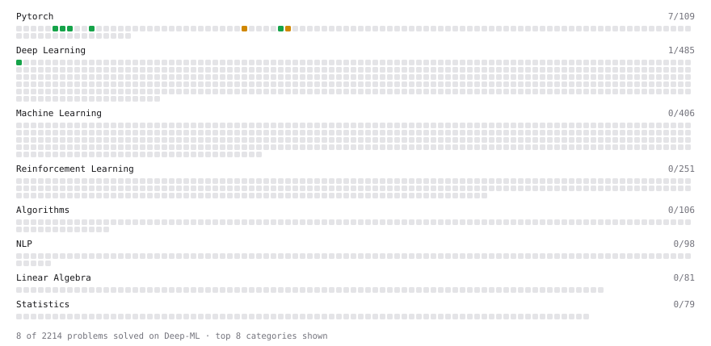

# Deep-ML

My machine learning practice from [Deep-ML](https://www.deep-ml.com). Every solution here was written by hand.

**13** solved · 11 problems · 2 labs · 0 math

[**Browse the interactive portfolio**](https://Asim-108.github.io/deep-ml/) to replay this filling in over time.

## Problems

| | Difficulty | Solved | |
| --- | --- | --- | --- |
| [Batch a TensorDataset with DataLoader](https://www.deep-ml.com/problems/1237) | easy | 2026-10-11 | [solution](problems/1237-batch-a-tensordataset-with-dataloader) |
| [Build a Dataset and Use It with a DataLoader](https://www.deep-ml.com/problems/899) | easy | 2026-10-10 | [solution](problems/0899-build-a-dataset-and-use-it-with-a-dataloader) |
| [Build a Linear Regression Model with nn.Module](https://www.deep-ml.com/problems/885) | easy | 2026-10-10 | [solution](problems/0885-build-a-linear-regression-model-with-nn-module) |
| [Build an MLP with nn.Sequential](https://www.deep-ml.com/problems/887) | easy | 2026-10-10 | [solution](problems/0887-build-an-mlp-with-nn-sequential) |
| [Run One Training Step: Forward, Loss, Backward, Optimizer](https://www.deep-ml.com/problems/886) | easy | 2026-10-10 | [solution](problems/0886-run-one-training-step-forward-loss-backward-optimizer) |
| [Sigmoid Activation Function Understanding](https://www.deep-ml.com/problems/22) | easy | 2026-10-09 | [solution](problems/0022-sigmoid-activation-function-understanding) |
| [Single Linear Neuron Forward](https://www.deep-ml.com/problems/1224) | easy | 2026-10-10 | [solution](problems/1224-single-linear-neuron-forward) |
| [Vector Addition](https://www.deep-ml.com/problems/1202) | easy | 2026-11-16 | [solution](problems/1202-vector-addition) |
| [Your First CUDA Kernel: Thread Index](https://www.deep-ml.com/problems/1201) | easy | 2026-11-13 | [solution](problems/1201-your-first-cuda-kernel-thread-index) |
| [One Training Step](https://www.deep-ml.com/problems/1219) | medium | 2026-10-10 | [solution](problems/1219-one-training-step) |
| [Two-Layer MLP Forward Pass](https://www.deep-ml.com/problems/1225) | medium | 2026-10-10 | [solution](problems/1225-two-layer-mlp-forward-pass) |

## Labs

| | Difficulty | Solved | |
| --- | --- | --- | --- |
| [MNIST: Design-Your-Own tiny Pytorch Model](https://www.deep-ml.com/labs/2) | medium | 2026-10-11 | [solution](labs/0002-mnist-design-your-own-tiny-pytorch-model) |
| [Train a Tiny CNN Image Classifier](https://www.deep-ml.com/labs/91c76ab2-7d3a-43a7-98ce-385aab6f1691) | hard | 2026-10-11 | [solution](labs/91c76ab2-7d3a-43a7-98ce-385aab6f1691-train-a-tiny-cnn-image-classifier) |

---

_This file is regenerated by Deep-ML on every push._
